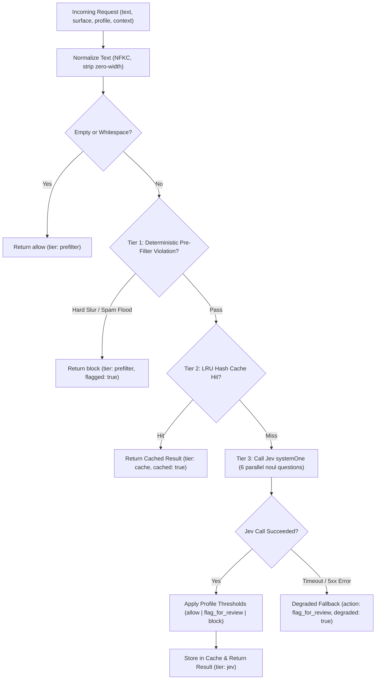

# Jev UGC Content Filtering System — Design Specification

**Date:** 2026-10-26  
**Topic:** Stateless, reusable User-Generated Content (UGC) moderation engine and Edge HTTP API powered by TypeSafe AI's **Jev** decision model for Apple App Store Review Guideline 1.2 compliance.

---

## 1. Overview & Goals

Apple App Store Review Guideline 1.2 (Safety — User-Generated Content) requires any mobile application featuring UGC (comments, posts, chat messages, usernames, profile bios, AI prompts) to implement a mechanism for filtering objectionable and abusive material prior to or upon publication.

This project provides a **dual-mode TypeScript moderation system** that can be reused across any mobile app:
1. **Core Moderation Library (`src/core/`)**: An importable TypeScript library implementing a 3-tier filtering pipeline (Deterministic Pre-Filter → Normalized Hash Cache → Single-Pass Jev Evaluation).
2. **Stateless Edge HTTP API (`src/server/`)**: A lightweight **Hono** HTTP service exposing `POST /v1/moderate` and `GET /health`, deployable to Cloudflare Workers, Vercel, Bun, or Node.js, allowing iOS (Swift), Android, React Native, or Flutter apps (and their backends) to evaluate UGC without exposing the upstream `TYPESAFE_API_KEY`.

### Non-Goals
- Storing user content, user reports, or block lists in a persistent database (this service is strictly a stateless content evaluation layer).
- Image, audio, or video moderation (Jev is a text decision model; this system strictly evaluates text UGC).

---

## 2. System Architecture & Module Structure

```text
jev-content-filtering/
├── package.json
├── tsconfig.json
├── vitest.config.ts
├── .env.example
├── src/
│   ├── index.ts                 # Public library exports (moderateContent, createModerator, types)
│   ├── core/
│   │   ├── types.ts             # Data contracts (ModerationRequest, ModerationResult, PolicyProfile, etc.)
│   │   ├── normalize.ts         # Text normalization (NFKC, zero-width stripping, leetspeak normalization)
│   │   ├── prefilter.ts         # Tier 1: Deterministic length, slur, URL flood, and repetition checks
│   │   ├── cache.ts             # Tier 2: Pluggable CacheStore interface + in-memory LRU cache with TTL
│   │   ├── policies.ts          # Apple Guideline 1.2 category definitions, prompts, and threshold profiles
│   │   ├── jev-evaluator.ts     # Tier 3: @typesafe-ai/sdk wrapper running parallel noul questions
│   │   └── moderator.ts         # Pipeline orchestrator (Tier 1 -> Tier 2 -> Tier 3 + fallback handling)
│   └── server/
│       ├── app.ts               # Hono HTTP application factory (`createApp`)
│       ├── index.ts             # Node.js / Edge server entrypoint
│       └── middleware/
│           ├── auth.ts          # Per-app API key authentication (`X-API-Key` / `Authorization: Bearer`)
│           └── rate-limit.ts    # In-memory sliding-window rate limiter per API key + client IP
└── tests/
    ├── core/
    │   ├── normalize.test.ts
    │   ├── prefilter.test.ts
    │   ├── cache.test.ts
    │   └── moderator.test.ts
    └── server/
        └── app.test.ts
```

### Component Boundaries
- **`normalize.ts`**: Pure functions transforming raw input text into:
  - `cleanedText`: Trimmed, Unicode `NFKC`-normalized text with zero-width characters (`\u200B-\u200D`, `\uFEFF`) removed.
  - `canonicalKeyText`: Lowercased, whitespace-collapsed string used for cache key hashing.
  - `deobfuscatedText`: Leetspeak/symbol-normalized string (e.g., `@` → `a`, `$` → `s`, `1`/`!` → `i`, `0` → `o`) used strictly for Tier 1 exact-slur matching without altering the text sent to Jev.
- **`prefilter.ts`**: Evaluates `cleanedText` and `deobfuscatedText` in <1ms at zero cost:
  - Empty/whitespace-only text returns `action: "allow"`, `flagged: false`, `reasons: []`, and `0.0` across all category scores.
  - Word-bounded severe slurs and hate terms (avoiding Scunthorpe false positives like `"class"` or `"assassin"`) return `action: "block"`, `flagged: true`, `reasons: ["hate_speech"]` (or `["harassment"]` for severe targeted abuse phrases), with score `1.0` for the triggered category and `0.0` for others.
  - Excessive URL spam (>3 URLs by default) or extreme character repetition (>12 identical consecutive characters) returns `action: "block"`, `flagged: true`, `reasons: ["spam_or_scam"]`, with `scores.spam_or_scam = 1.0`.
- **`cache.ts`**: Computes `SHA-256(profile + ":" + surface + ":" + canonicalKeyText + ":" + canonicalContext)` and stores `ModerationResult` items in a bounded LRU map (default max `5,000` entries, TTL `1 hour`).
- **`jev-evaluator.ts`**: Wraps `@typesafe-ai/sdk` (`TypeSafeClient.systemOne`) with a configurable timeout (default `3,000ms`), evaluating all six Apple Guideline 1.2 categories in a single parallel request.
- **`moderator.ts`**: Coordinates Tiers 1–3, applies the active `PolicyProfile` thresholds to Jev probabilities, records execution latency, and handles upstream failure modes.
- **`server/app.ts`**: Exposes HTTP endpoints with JSON schema validation, authentication, and rate limiting.

---

## 3. 3-Tier Filtering Data Flow



---

## 4. Jev Evaluation Rubric & Policy Profiles

### 4.1 Jev Input State
`jev-evaluator.ts` sends a structured JSON string as `state` to `client.systemOne({ model: "jev-latest", state, questions })`:

```json
{
  "surface": "comment",
  "content_to_evaluate": "The user-submitted text",
  "parent_context": "Optional parent post or conversation context"
}
```

### 4.2 Six Parallel `noul` Questions
All six categories are evaluated simultaneously in a single request and return calibrated probabilities in `[0.0, 1.0]`:

| Category ID | Jev `noul` Proposition |
|---|---|
| `hate_speech` | `"The content in content_to_evaluate promotes hatred, discrimination, slurs, or demeaning attacks against a group or individual based on race, religion, gender, sexual orientation, disability, or nationality."` |
| `harassment` | `"The content in content_to_evaluate bullies, insults, stalks, doxxes, or targets a person with abusive or demeaning language, rather than benign slang or general frustration."` |
| `sexual_content` | `"The content in content_to_evaluate contains explicit sexual descriptions, pornography, sexual solicitation, or non-consensual sexual material."` |
| `violence_or_threats` | `"The content in content_to_evaluate threatens, encourages, or depicts realistic physical violence, graphic harm, illegal acts, or weapons attacks."` |
| `self_harm` | `"The content in content_to_evaluate encourages, instructs, or expresses intent for suicide, self-injury, or eating disorders."` |
| `spam_or_scam` | `"The content in content_to_evaluate is commercial spam, phishing, financial scam solicitation, or deceptive promotional links."` |

### 4.3 Surface-to-Profile Mapping
When `profile` is omitted from the request, it is derived from `surface`:
- `username`, `bio` → `strict`
- `comment`, `post`, `ai_prompt` (or omitted `surface`) → `standard`
- `chat` → `lenient`

### 4.4 Profile Thresholds

For each category, if the probability meets or exceeds `blockThreshold`, the category is added to `reasons` and requires `action = "block"`. Otherwise, if it meets or exceeds `reviewThreshold`, the category is added to `reasons` and requires at least `action = "flag_for_review"`.

| Category | `strict` (review / block) | `standard` (review / block) | `lenient` (review / block) |
|---|---|---|---|
| `hate_speech` | `0.35` / `0.60` | `0.45` / `0.75` | `0.50` / `0.75` |
| `self_harm` | `0.35` / `0.60` | `0.45` / `0.75` | `0.45` / `0.75` |
| `sexual_content` | `0.35` / `0.60` | `0.50` / `0.75` | `0.60` / `0.85` |
| `violence_or_threats` | `0.40` / `0.70` | `0.50` / `0.80` | `0.55` / `0.80` |
| `harassment` | `0.40` / `0.70` | `0.50` / `0.85` | `0.65` / `0.90` |
| `spam_or_scam` | `0.40` / `0.70` | `0.55` / `0.85` | `0.65` / `0.90` |

- `flagged` is `true` whenever `action` is `"block"` or `"flag_for_review"`, and `false` when `action` is `"allow"`.

---

## 5. HTTP API Specification

### 5.1 `POST /v1/moderate`

**Headers:**
- `Content-Type: application/json`
- `X-API-Key: <app-api-key>` or `Authorization: Bearer <app-api-key>` (required when `MODERATION_API_KEYS` is configured)

**Request Body:**
```typescript
interface ModerationRequest {
  text: string; // Required. Max 2,000 characters (configurable via MAX_TEXT_LENGTH).
  surface?: "username" | "bio" | "comment" | "post" | "chat" | "ai_prompt";
  profile?: "strict" | "standard" | "lenient";
  context?: string; // Optional surrounding context. Max 500 characters.
}
```

**Response Body (`200 OK`):**
```typescript
type ModerationCategory =
  | "hate_speech"
  | "harassment"
  | "sexual_content"
  | "violence_or_threats"
  | "self_harm"
  | "spam_or_scam";

interface ModerationResult {
  flagged: boolean;
  action: "allow" | "flag_for_review" | "block";
  reasons: ModerationCategory[];
  scores: Record<ModerationCategory, number>;
  meta: {
    tier: "prefilter" | "cache" | "jev";
    profile: "strict" | "standard" | "lenient";
    surface: "username" | "bio" | "comment" | "post" | "chat" | "ai_prompt";
    cached: boolean;
    degraded: boolean;
    latencyMs: number;
  };
}
```

**Error Responses:**
- `400 Bad Request`: Missing `text`, non-string `text`, `text` exceeds `MAX_TEXT_LENGTH` (default 2,000 chars), `context` exceeds 500 chars, or invalid `surface`/`profile` enum value.
- `401 Unauthorized`: Missing or invalid API key when authentication is enabled.
- `429 Too Many Requests`: Rate limit exceeded (includes `Retry-After` header).

### 5.2 `GET /health`
Returns `{ "status": "ok" }` with `200 OK` (unauthenticated, for load balancer and uptime checks).

---

## 6. Security, Error Handling & Resilience

1. **API Key Protection**: Mobile apps authenticate using app-scoped keys (`MODERATION_API_KEYS="ios_app_1:key_abc,android_app_1:key_xyz"`). The upstream `TYPESAFE_API_KEY` remains strictly server-side.
2. **Locked Evaluation Schema**: Clients cannot supply custom prompts or Jev questions; they can only submit `text`, `context`, `surface`, and `profile`. This prevents prompt injection or key abuse for general-purpose AI tasks.
3. **Sliding-Window Rate Limiting**: Default `60` requests per `60,000ms` window per `(apiKey + clientIP)`, configurable via `RATE_LIMIT_MAX` and `RATE_LIMIT_WINDOW_MS`.
4. **Upstream Timeout & Graceful Degradation**:
   - Jev requests are bounded by `JEV_TIMEOUT_MS` (default `3,000ms`).
   - If Jev throws a timeout, network error, or `5xx` error after Tier 1 pre-filtering has passed, `moderator.ts` does **not** cache the failure and returns a safe degraded response:
     - `flagged: true`
     - `action: "flag_for_review"`
     - `reasons: []`
     - `meta.degraded: true`
     - `meta.tier: "jev"`

---

## 7. Testing Strategy

All tests run via **Vitest** without requiring a live `TYPESAFE_API_KEY`:
1. **`tests/core/normalize.test.ts`**: Verifies Unicode normalization, zero-width stripping, whitespace collapsing, and leetspeak deobfuscation.
2. **`tests/core/prefilter.test.ts`**: Verifies empty text allowance, severe slur blocking, obfuscated slur detection (`s h i t` / leetspeak), Scunthorpe safe-word protection (`"class"`, `"pass"`, `"basement"`, `"workout kicked my ass"`), URL flood blocking, and repeated character blocking.
3. **`tests/core/cache.test.ts`**: Verifies deterministic key hashing, cache hits on normalized-equivalent strings, profile/surface isolation, TTL expiration, and LRU eviction at max capacity.
4. **`tests/core/moderator.test.ts`**: Verifies 3-tier orchestration using a mock `JevEvaluator`:
   - Tier 1 blocks skip Tier 2 and Tier 3.
   - Tier 2 cache hits skip Tier 3.
   - Tier 3 maps Jev probabilities across `strict`, `standard`, and `lenient` profiles to `allow`, `flag_for_review`, and `block`.
   - Jev timeout/error triggers degraded `flag_for_review` fallback without caching the degraded response.
5. **`tests/server/app.test.ts`**: Verifies `POST /v1/moderate` and `GET /health` via Hono's test client, covering `200 OK`, `400 Bad Request` payload validation, `401 Unauthorized` API key checks, and `429 Too Many Requests` rate limiting.
